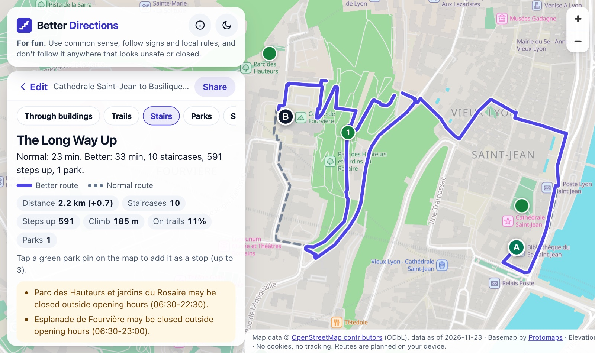
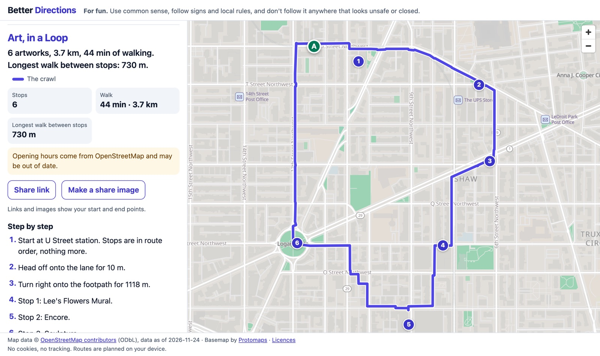
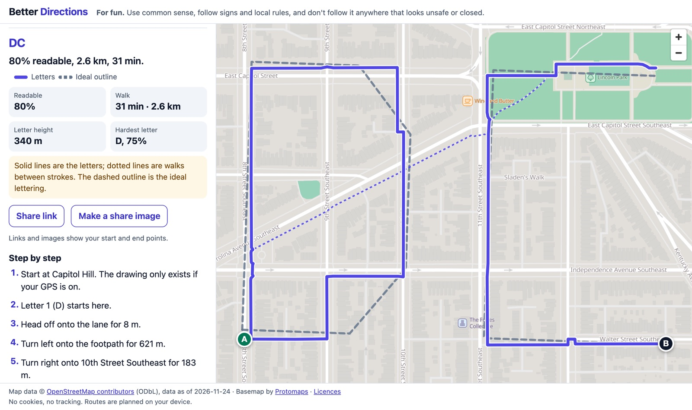
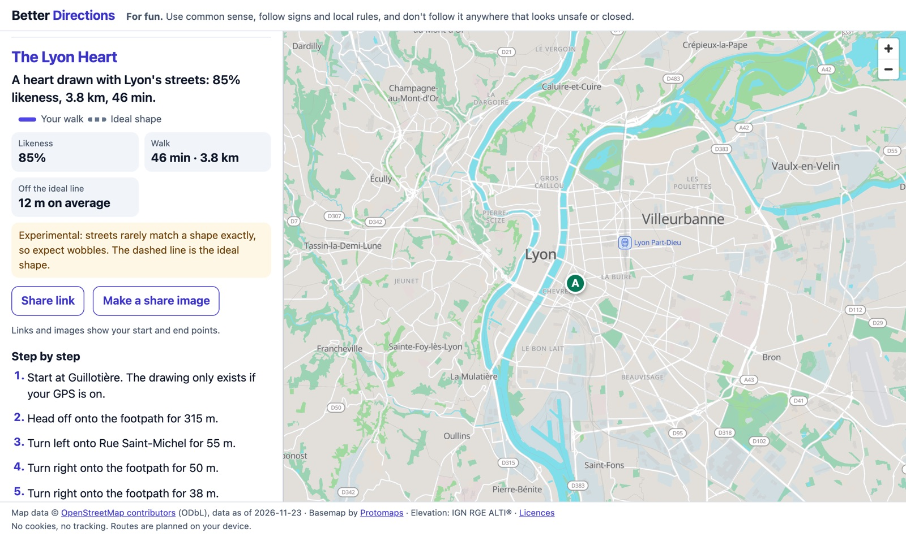
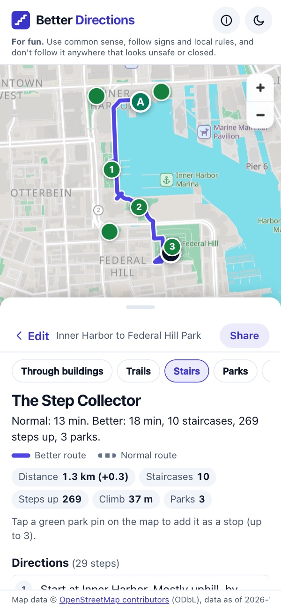
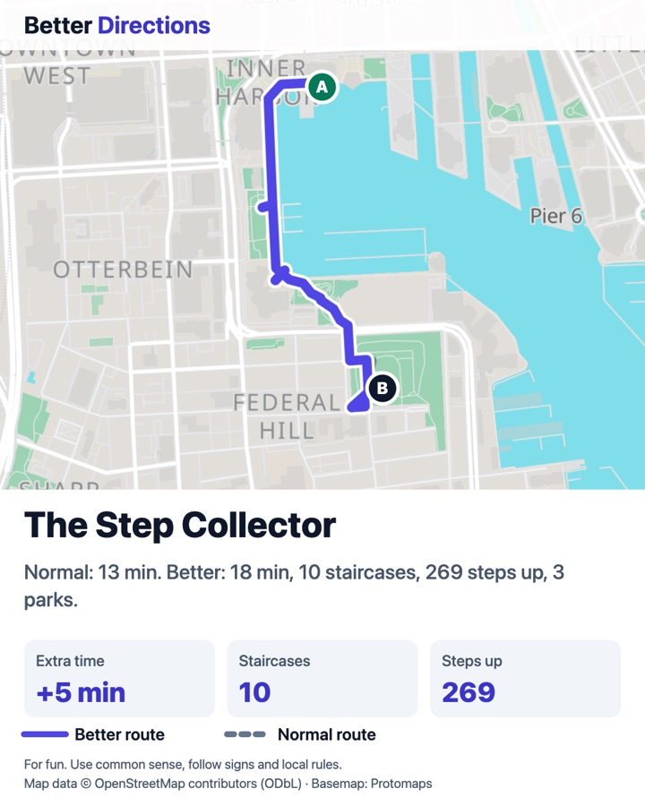

# Better Directions

A walking router that takes the long way round on purpose, for Lyon, Washington DC, Arlington and Alexandria, Silver Spring and Bethesda, Richmond, Baltimore, Chicago, Newberg and Dundee in Oregon, Copenhagen and Malmö. Pick a start, an end and a mode, and it finds the *better* route: up every staircase, through the traboules, along the dirt paths, past the bakeries. The normal route is drawn next to it, with the cost:

> Normal: 23 min. Better: 33 min, 10 staircases, 591 steps up.
> *(Cathédrale Saint-Jean to the Basilique de Fourvière, Stairs mode)*

**For fun.** Use common sense, follow signs and local rules, and don't follow it anywhere that looks unsafe or closed.

It's a static site with no server, accounts or tracking. Routes are planned on your phone, and each area is a separate download, fetched only when you pick it. "Nearest to me" picks the closest area on your device.



## Modes

- **Through buildings**: mapped public passages, arcades and shopping-centre corridors. Terreaux to Croix-Rousse walks through 10 buildings for 13 extra minutes.
- **Trails**: dirt and gravel over pavement. Jean Macé to Bellecour is half trail.
- **Stairs**: goes out of its way for staircases, climbed upwards. Saint-Jean to Fourvière: 591 steps up, 10 extra minutes.
- **Parks**: collects parks. Terreaux to Croix-Rousse passes eight.
- **Snacks**: bakeries, pâtisseries, chocolatiers, ice cream and cafés. Bellecour to Terreaux: 4 bakeries and 10 other stops for 4 extra minutes.
- **Left turns only**: left or straight on, never right if it can help it. Saint-Jean to Fourvière: 33 lefts, no rights.
- **Most inconvenient**: zig-zags, needless ups and downs, nothing straight, but never more busy-road crossings than the normal route. Bellecour to the Terreaux: 220 turns, and 158 places where it could have gone straight.
- **Random**: a detour picked by a seed, so the same link gives the same route. The scenic route. Very scenic.

Every route gets a name, and can be shared as a link or as an image drawn on your phone. Parks near the route show as pins; tap one to add it as a stop. A few famous routes are listed in the planner to try.

## Crawls and workouts

A crawl visits a few artworks, pubs or wine bars in a sensible order, looping back or ending somewhere else. Stops are numbered pins you can swap or skip. Pub and wine crawls keep the walks short, prefer lit streets, and flag places whose hours suggest they close before the evening. See [docs/CRAWLS.md](docs/CRAWLS.md) for what counts as a stop.



A workout is a loop from your start of 20 minutes to two hours, collecting staircases, hills or both. It shows the staircases, steps and metres climbed, and notes any stretch tagged as unlit. It makes no claims about calories.

There's also an experimental Draw option that finds a walk drawing a heart, star, square or one-stroke letter with real streets, and scores the likeness. Spell a word does the same for a word or initials of up to six letters, with dotted walks between strokes. Grids work much better than Lyon's old town. See [docs/GPS_ART.md](docs/GPS_ART.md).

 

 

## Safety

These rules are hard-coded, and no mode or setting can change them:

- Walking only. Never on ways tagged `access=private|no` or `foot=no|private`, on construction, or on any `railway=*` way. Never on motorways or trunk roads unless they have `foot=yes` or a mapped sidewalk. Railways are crossed only at mapped crossings with foot access.
- "Through a building" means a mapped passage (`tunnel=building_passage`, `covered=yes`, `highway=corridor` or `indoor=corridor`) and only where it's plausibly public: through a shop, mall or station, or with public access tags, a street name, or a confirmation against the city's list. Passages and corridors through flats, offices, campuses and hospitals are left out.
- Streets that run under a building without a mapped tunnel are kept, but the directions say so.
- Passages, corridors and parks that may close are flagged, with their hours where mapped. Late at night there's an extra warning.
- A better route takes at most four times the normal walking time, and never more than an hour unless the normal walk is longer. Tick "Longer walk" (or tap "Allow a longer walk" on a route that's too long for the hour) and it may take up to two hours, and may always add up to half an hour to the normal walk, so a walk that's already long still gets a detour. Routes through stops you pick are measured against the normal route through the same stops. Crawls and workouts are limited to the length you pick, up to two hours; shapes to an hour, or an hour and a half for the 1 h 15 option. Walks over an hour say roughly when you'd finish, and warn if that's late.

The rules run when the graph is built, again when the page loads, during the search, and on every finished route. The Python build and the TypeScript router pass the same cases in [safety/cases.json](safety/cases.json). A property test plans random routes, loops, crawls and drawings in every area and checks each one independently; before this release it ran about 83,000 of them. Details are in [docs/SECURITY.md](docs/SECURITY.md).

The build is also stricter than the rules above in places. It excludes escalators with unknown direction, mountain paths, gaps in fences that aren't gates, and footways drawn through buildings.

## Privacy

The page talks to no one but its own site: tiles, fonts, data and code are all self-hosted, and a strict Content-Security-Policy enforces it. There are no cookies, no storage and no analytics.

A word you spell stays on your device unless you choose to put it in a link. Your location is used only if you tap "Start at my location" or "Nearest to me". It stays on your device, and it's snapped to the nearest path before it goes into a link. Shared links and images do show your start and end points; the page says so next to the share buttons.

## What's unusual about it

- **No routing server.** Route planners usually send your trip to a server. This one ships each area's walking graph to the page and plans on your phone, in a background thread. The site is plain static files, so there's no API bill, no per-request cost and nobody who sees your trips.
- **It loads only what a route can reach, exactly.** DC and Chicago are cut into tiles about a kilometre square. Every route has a time cap and nobody walks faster than 6 km/h, so a trip can only reach points inside an ellipse around its start and end (a circle for loops and drawings). The page fetches just the tiles that ellipse touches. That follows from the geometry; it isn't a guess. A test plans random requests of every kind on the whole graph and on tiles, and requires identical routes, names and directions. DC's first route went from 16 seconds to 9.
- **Safety rules written twice.** They're in Python for the build and TypeScript for the page, and both must give the same answers on a shared list of cases. The page re-audits the graph when it loads and re-checks every finished route, and a property test plans tens of thousands of random walks and checks each one independently.
- **The same link gives the same route.** Random detours and route names come from a seed and the trip itself, so a shared link reproduces the walk exactly, whichever tiles happen to be loaded.
- **Private by construction.** There's no backend to send anything to. A strict Content-Security-Policy blocks third-party requests, nothing is stored, and share images are drawn on the device.

## Performance

Measured on an emulated low-end phone (6× slower CPU, slow 4G, empty cache), the first route on a first visit is ready in 4 to 10 seconds depending on the area, mostly spent downloading the walking graph. Timings vary by about half a second from run to run.

| Area | Download | First route |
|---|---:|---:|
| Lyon | 3.3 MB | 9.5 s |
| Arlington and Alexandria | 3.2 MB | 9.2 s |
| Washington, DC | 2.9 MB* | 8.9 s |
| Chicago | 2.7 MB* | 8.0 s |
| Baltimore | 2.0 MB | 7.2 s |
| Copenhagen | 1.8 MB | 6.6 s |
| Richmond | 1.7 MB | 6.3 s |
| Silver Spring and Bethesda | 1.4 MB | 5.6 s |
| Malmö | 1.0 MB | 5.0 s |
| Newberg | 0.6 MB | 4.0 s |
| Dundee | 0.4 MB | 3.7 s |

\* DC and Chicago load in tiles, so this is what the first route needed; their whole graphs would be 5.5 and 3.4 MB, and took 16 and 11 seconds.

After that, a new route takes about a quarter of a second. In DC and Chicago, a route somewhere new first fetches the tiles it can reach; tiles already loaded aren't fetched again. The page and planner use under 20 MB of JavaScript heap, plus the graph itself.

## Known issues

- Opening hours are shown but not checked against the clock, so a route can send you towards a park that has already shut. The late-night warning is the only hint.
- It hasn't been tested on a real low-end phone, only emulated.
- Copenhagen and Malmö have no elevation data yet, so climbs, steps up and hill workouts aren't available there; staircases are still counted. The page says so under the area picker, on every result and in the footer.
- Kastellet in Copenhagen is tagged as military land in OpenStreetMap, so routes never enter it, although it's open to the public by day.
- Wine bars are rarely tagged as such in OpenStreetMap, so wine crawls are thin, especially in the US.
- Traboules in Lyon are private buildings opened to the public by agreement with the city. The list of agreed ones changes, and the app relies on OpenStreetMap tags and names rather than that list.

## Data and licences

The code is [MIT](LICENSE). Map data is © [OpenStreetMap contributors](https://www.openstreetmap.org/copyright), under the [ODbL](https://opendatacommons.org/licenses/odbl/1-0/); Lyon's extract is dated 2026-11-23 ([data/lyon/SOURCE.md](data/lyon/SOURCE.md)). The US, Danish and Swedish extracts are dated 2026-11-24 (`data/<area>/SOURCE.md`). Elevation for Lyon is IGN RGE ALTI®, under the [Licence Ouverte 2.0](https://www.etalab.gouv.fr/licence-ouverte-open-licence/); for the US areas it's the USGS 3D Elevation Program (public domain). The basemap is from [Protomaps](https://protomaps.com), built from OpenStreetMap, with Noto Sans fonts (SIL OFL) and icons from tangrams/icons (MIT). Licences for the software in the page are in `licenses.txt`, linked from the footer.

## Running it locally

You need Python 3.12 and Node 22 or newer. The committed Lyon data is enough to run the app:

```sh
npm ci
npm run check          # typecheck, lint and all tests, including the safety property test
npm run pages:gz &     # build and serve at http://localhost:4174/better-directions/, like Pages (gzip, real 404s)
npm run smoke          # browser checks against it (needs a local Chromium-based browser)
npm run perf           # low-end phone emulation against it
npm run samples        # sample routes per mode, written to docs/SAMPLE_ROUTES.md
```

Rebuilding the data downloads about 550 MB once:

```sh
python3.12 -m venv .venv && .venv/bin/pip install -r requirements-dev.txt
PYTHONPATH=pipeline .venv/bin/python -m bdgraph.fetch   cities/lyon.json
PYTHONPATH=pipeline .venv/bin/python -m bdgraph.terrain cities/lyon.json
PYTHONPATH=pipeline .venv/bin/python -m bdgraph.build   cities/lyon.json
npm run tiles -- lyon     # what the page loads: the whole graph, or tiles for big areas (build and dev run this too)
PYTHONPATH=pipeline .venv/bin/python -m bdgraph.tiles   cities/lyon.json --build 20261123
PYTHONPATH=pipeline .venv/bin/python -m bdgraph.places  cities/lyon.json
.venv/bin/python -m pytest
```

## More

- [docs/architecture.md](docs/architecture.md): how it's built, and why.
- [docs/ADDING_A_CITY.md](docs/ADDING_A_CITY.md): adding a city.
- [docs/GRAPH_FORMAT.md](docs/GRAPH_FORMAT.md): the walking graph file.
- [CONTRIBUTING.md](CONTRIBUTING.md) and [CHANGELOG.md](CHANGELOG.md).
