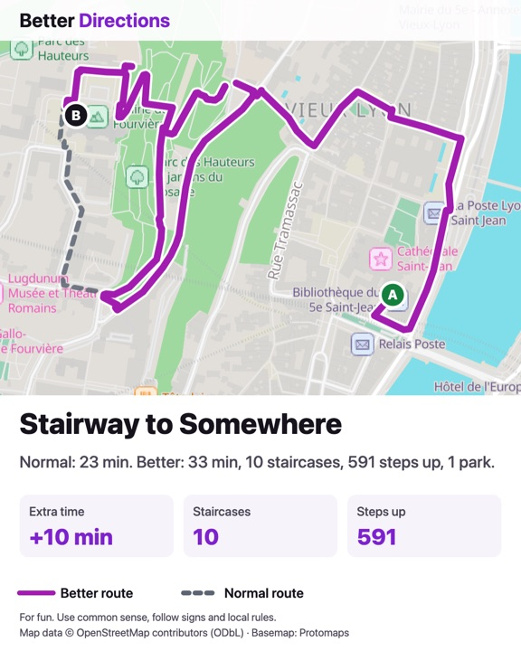
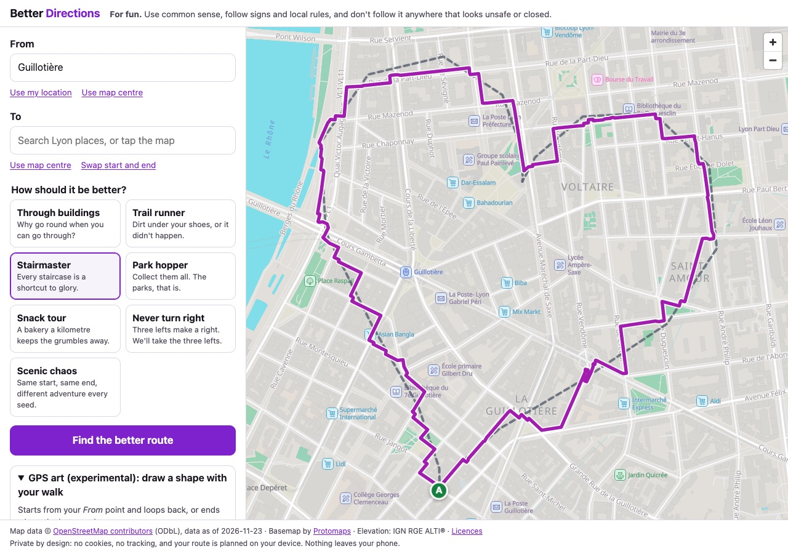

# Better Directions

A deliberately silly walking-directions app for Lyon. Pick a start and an end, choose a mode, and it finds the *better* route: through the traboules, up every staircase, along every dirt path, past every bakery. The normal route is always drawn next to it, with the cost of the fun:

> **Normal: 23 min. Better: 33 min, 10 staircases, 591 steps up.**
> *(Cathédrale Saint-Jean → Basilique de Fourvière, Stairmaster)*

> **For fun.** Use common sense, follow signs and local rules, and don't follow it anywhere that looks unsafe or closed.

It's a static site: no server, no accounts, no tracking. The whole route is planned on your phone.


## The modes

| Mode | What it does | Example (Lyon) |
|---|---|---|
| **Through buildings** | Mapped public passages, arcades and mall corridors. *Why go round when you can go through?* | Terreaux → Croix-Rousse: 10 buildings walked through, +9 min |
| **Trail runner** | Dirt and gravel over pavement | Jean Macé → Bellecour: half the walk on trails |
| **Stairmaster** | Goes out of its way for staircases, climbed *upwards* | Saint-Jean → Fourvière: 591 steps up, +10 min |
| **Park hopper** | Collects parks | Terreaux → Croix-Rousse: 8 parks |
| **Snack tour** | Bakeries, pâtisseries, chocolatiers, ice cream, cafés | Bellecour → Terreaux: 4 bakeries and 10 more stops, +4 min |
| **Never turn right** | Left turns only (or straight on) | Saint-Jean → Fourvière: 33 lefts, 0 rights |
| **Scenic chaos** | Random from a seed; every seed is a new, shareable adventure | Part-Dieu → Saint-Jean, seed 42: +12 min |

Every route gets a generated name ("Stairway to Somewhere", "The Croissant Crawl"). Routes can be shared as a link or as an image drawn on your phone. The landing page has eight famous better routes to try.



### GPS art (experimental)

Walk a heart, a star, a square or a one-stroke letter, drawn with real streets and scored for likeness. See [docs/GPS_ART.md](docs/GPS_ART.md).



## The safety rules

These are hard-coded and not configurable by any mode or setting:

- **Walking only:**
  - Never on ways tagged `access=private|no` or `foot=no|private`.
  - Never on motorways or trunk roads, unless `foot=yes` or a mapped sidewalk.
  - Never on construction, or on any `railway=*` way.
  - Railways are crossed only at mapped crossings with foot access.
- **"Through a building" means mapped public passages only:** `tunnel=building_passage`, `covered=yes`, `highway=corridor` or `indoor=corridor`. Streets that run under a building without a mapped tunnel are kept but disclosed.
- **Closures are flagged.** Passages, corridors and parks that may close get a "may be closed outside opening hours" note, with the hours where mapped. Late at night there's an extra warning.
- **Detour cap:** a "better" route takes at most 4× the normal walking time, and never more than an hour (unless the normal walk is itself longer). GPS art is limited to an hour.
- **Defence in depth.** The rules run when the graph is built. They run again when the page loads (any edge breaking a rule is disabled), during the search, and on every finished route. Both the Python build and the TypeScript router pass the same shared cases in [safety/cases.json](safety/cases.json).
- **A property test** plans thousands of random Lyon routes in every mode, plus GPS art, plus a deliberately tampered graph. It fails if any route breaks a rule or the cap. Before launch it ran at 10× the CI count.

The build is also stricter than the brief in places: unknown-direction escalators, alpine paths, fences without gates, and footways cutting through buildings are all excluded. Details are in [docs/DECISIONS.md](docs/DECISIONS.md) (D-006).

## Privacy: nothing leaves your phone

- The page makes **no requests to anyone but its own site.** Map tiles, fonts, data and code are all self-hosted. A strict Content-Security-Policy enforces it.
- **No cookies, no storage, no analytics.**
- Your **location** is used only if you tap "Use my location". It stays on your device, and it's snapped to the nearest path before it goes into a shareable link.
- **Shared links and images show your start and end points.** The page says so next to the Share buttons.

More in [docs/SECURITY.md](docs/SECURITY.md).

## Data, licences and attribution

- **Code:** [MIT](LICENSE).
- **Map data:** © [OpenStreetMap contributors](https://www.openstreetmap.org/copyright), under the [ODbL](https://opendatacommons.org/licenses/odbl/1-0/). Lyon's extract is dated 2026-11-23 ([data/lyon/SOURCE.md](data/lyon/SOURCE.md)).
- **Elevation (Lyon):** IGN RGE ALTI®, [Licence Ouverte 2.0](https://www.etalab.gouv.fr/licence-ouverte-open-licence/).
- **Basemap:** [Protomaps](https://protomaps.com), built from OpenStreetMap.
- **Fonts and sprites:** Noto Sans (SIL OFL) and sprites derived from MIT-licensed tangrams/icons.
- **Third-party software in the page:** listed with full licence texts in `licenses.txt`, linked from the footer.

## Running it

**Requirements:** Python 3.12 and Node 22 or newer.

```sh
# The app, using the committed Lyon data
npm ci
npm run check          # typecheck, lint and all tests, including the safety property test
npm run pages:local    # build and serve at http://localhost:4173/better-directions/ (the real sub-path)
npm run smoke          # browser checks against that preview (needs a local Chromium-based browser)
npm run perf           # low-end phone emulation (6x CPU, slow 4G)
npm run samples        # sample routes per mode -> docs/SAMPLE_ROUTES.md
```

```sh
# Rebuilding the data (downloads about 550 MB once)
python3.12 -m venv .venv && .venv/bin/pip install -r requirements-dev.txt
PYTHONPATH=pipeline .venv/bin/python -m bdgraph.fetch   cities/lyon.json
PYTHONPATH=pipeline .venv/bin/python -m bdgraph.terrain cities/lyon.json
PYTHONPATH=pipeline .venv/bin/python -m bdgraph.build   cities/lyon.json
PYTHONPATH=pipeline .venv/bin/python -m bdgraph.tiles   cities/lyon.json --build 20261123
PYTHONPATH=pipeline .venv/bin/python -m bdgraph.places  cities/lyon.json
.venv/bin/python -m pytest
```

## Adding a city

See [docs/ADDING_A_CITY.md](docs/ADDING_A_CITY.md).

## How it's built

- **Pipeline (Python, pyosmium):** builds a compact walking graph ([docs/GRAPH_FORMAT.md](docs/GRAPH_FORMAT.md)).
- **Router (TypeScript, in a Web Worker):** turn-aware A*, a Tobler walking-time model on real terrain, and seven modes.
- **Map:** MapLibre on self-hosted Protomaps tiles.
- **Hosting:** a static site for GitHub Pages at `mohanenm.github.io/better-directions/`.
- **The story:** decisions, open questions and progress are in [docs/](docs/), starting with [docs/PROGRESS.md](docs/PROGRESS.md).
