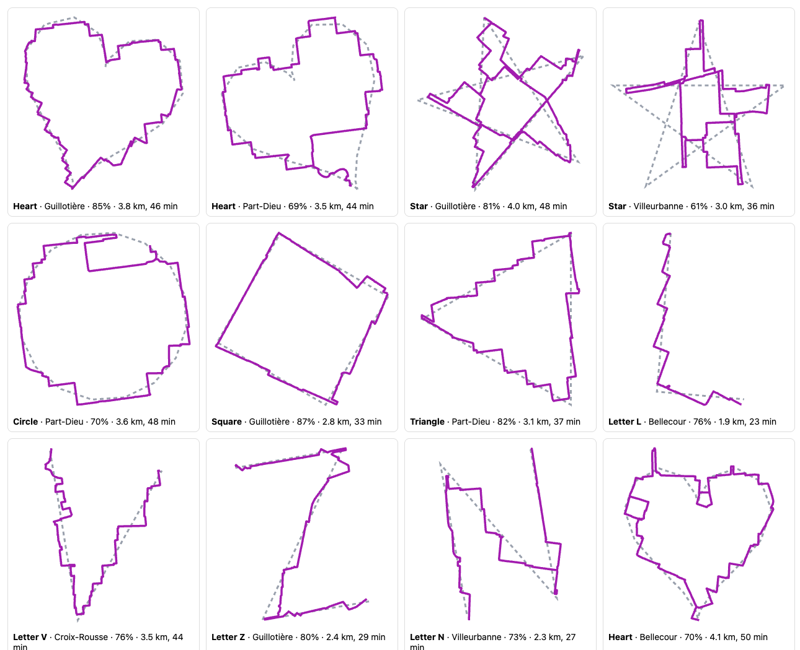

# Better Directions

A deliberately silly walking-directions app. Pick a start and an end, choose a mode, and it finds the *better* route: through building passages, up every staircase, along every trail, through every park. It always shows the normal route next to it, with the cost of the fun.

> **For fun.** Use common sense, follow signs and local rules, and don't follow it anywhere that looks unsafe or closed.

Status: work in progress. Phases 0–6 are done, including experimental GPS art. Hardening and launch prep are next. See [docs/PROGRESS.md](docs/PROGRESS.md).

## The modes

- **Through buildings:** traboules, arcades and mall corridors. Why go round when you can go through?
- **Trail runner:** dirt and gravel over pavement.
- **Stairmaster:** every staircase is a shortcut to glory. Climbed upwards, naturally.
- **Park hopper:** collect them all. The parks, that is.
- **Snack tour:** a bakery a kilometre keeps the grumbles away.
- **Never turn right:** three lefts make a right.
- **Scenic chaos:** same start, same end, a different adventure every seed.

The landing page has eight famous better routes, like the Fourvière Stair Assault and the Croissant Crawl. Every route gets a name, and can be shared as a link or as an image drawn on your phone.

**GPS art (experimental):** walk a heart, a star, a square or a one-stroke letter, drawn with real streets. See [docs/GPS_ART.md](docs/GPS_ART.md).



Every "better" route is capped at 4× the normal walking time, and never more than an hour, unless the normal walk is itself longer. See [docs/SAMPLE_ROUTES.md](docs/SAMPLE_ROUTES.md).

## Building the graph

```sh
python3.12 -m venv .venv
.venv/bin/pip install -r requirements-dev.txt
PYTHONPATH=pipeline .venv/bin/python -m bdgraph.fetch cities/lyon.json     # downloads ~534 MB once
PYTHONPATH=pipeline .venv/bin/python -m bdgraph.terrain cities/lyon.json   # elevations from IGN, cached
PYTHONPATH=pipeline .venv/bin/python -m bdgraph.tiles cities/lyon.json --build 20261123   # basemap tiles
PYTHONPATH=pipeline .venv/bin/python -m bdgraph.places cities/lyon.json    # places for search
PYTHONPATH=pipeline .venv/bin/python -m bdgraph.build cities/lyon.json
.venv/bin/python -m pytest
```

## Privacy

Nothing leaves your phone. The page makes no requests to anyone but its own site. It has no cookies, storage or analytics. Your location is used only if you tap "Use my location", and it stays on your device. See [docs/SECURITY.md](docs/SECURITY.md).

## The app (TypeScript)

```sh
npm ci
npm run check   # typecheck, lint, tests (including the safety property test)
npm run bench   # routing benchmark on the Lyon graph
npm run samples # sample routes per mode -> docs/SAMPLE_ROUTES.md
npm run dev     # local dev server
npm run build && npm run preview   # the real build at http://localhost:4173/better-directions/
npm run smoke   # browser smoke test against the preview (needs a local Chromium-based browser)
```

## Licences

- Code: [MIT](LICENSE).
- Map data: © OpenStreetMap contributors, available under the [ODbL](https://opendatacommons.org/licenses/odbl/1-0/).
- Elevation (Lyon): IGN RGE ALTI®, [Licence Ouverte 2.0](https://www.etalab.gouv.fr/licence-ouverte-open-licence/).
- Basemap: [Protomaps](https://protomaps.com). Fonts: Noto Sans (SIL OFL), in `app/public/basemap/fonts/OFL.txt`. Sprites are derived from MIT-licensed tangrams/icons.
