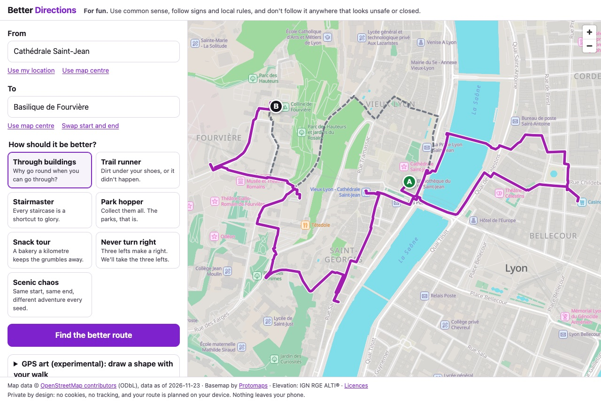

# Better Directions

A walking router for Lyon that takes the long way round on purpose. Pick a start, an end and a mode, and it finds the *better* route: up every staircase, through the traboules, along the dirt paths, past the bakeries. The normal route is drawn next to it, with the cost:

> Normal: 23 min. Better: 33 min, 10 staircases, 591 steps up.
> *(Cathédrale Saint-Jean to the Basilique de Fourvière, Stairs mode)*

**For fun.** Use common sense, follow signs and local rules, and don't follow it anywhere that looks unsafe or closed.

It's a static site with no server, accounts or tracking. Routes are planned on your phone.



## Modes

- **Through buildings**: mapped public passages, arcades and shopping-centre corridors. Terreaux to Croix-Rousse walks through 10 buildings for 13 extra minutes.
- **Trails**: dirt and gravel over pavement. Jean Macé to Bellecour is half trail.
- **Stairs**: goes out of its way for staircases, climbed upwards. Saint-Jean to Fourvière: 591 steps up, 10 extra minutes.
- **Parks**: collects parks. Terreaux to Croix-Rousse passes eight.
- **Snacks**: bakeries, pâtisseries, chocolatiers, ice cream and cafés. Bellecour to Terreaux: 4 bakeries and 10 other stops for 4 extra minutes.
- **Left turns only**: left or straight on, never right if it can help it. Saint-Jean to Fourvière: 33 lefts, no rights.
- **Most inconvenient**: zig-zags, needless ups and downs, nothing straight, but never more busy-road crossings than the normal route. Bellecour to the Terreaux: 220 turns, and 158 places where it could have gone straight.
- **Random**: a detour picked by a seed, so the same link gives the same route. The scenic route. Very scenic.

Every route gets a name, and can be shared as a link or as an image drawn on your phone. Parks near the route show as pins; tap one to add it as a stop. The Famous routes section has a few to try.

## Crawls and workouts

A crawl visits a few artworks, pubs or wine bars in a sensible order, looping back or ending somewhere else. Stops are numbered pins you can swap or skip. Pub and wine crawls keep the walks short, prefer lit streets, and flag places whose hours suggest they close before the evening. See [docs/CRAWLS.md](docs/CRAWLS.md) for what counts as a stop.

A workout is a 20, 30 or 45-minute loop from your start, collecting staircases, hills or both. It shows the staircases, steps and metres climbed, and notes any stretch tagged as unlit. It makes no claims about calories.

There's also an experimental Draw a shape section that finds a walk drawing a heart, star, square or one-stroke letter with real streets, and scores the likeness. Spell a word does the same for a name of up to ten letters, with dotted walks between strokes. Grids work much better than Lyon's old town. See [docs/GPS_ART.md](docs/GPS_ART.md).


## Safety

These rules are hard-coded, and no mode or setting can change them:

- Walking only. Never on ways tagged `access=private|no` or `foot=no|private`, on construction, or on any `railway=*` way. Never on motorways or trunk roads unless they have `foot=yes` or a mapped sidewalk. Railways are crossed only at mapped crossings with foot access.
- "Through a building" means a mapped passage (`tunnel=building_passage`, `covered=yes`, `highway=corridor` or `indoor=corridor`) and only where it's plausibly public: through a shop, mall or station, or with public access tags, a street name, or a confirmation against the city's list. Passages and corridors through flats, offices, campuses and hospitals are left out.
- Streets that run under a building without a mapped tunnel are kept, but the directions say so.
- Passages, corridors and parks that may close are flagged, with their hours where mapped. Late at night there's an extra warning.
- A better route takes at most four times the normal walking time, and never more than an hour unless the normal walk is longer. Routes through stops you pick are measured against the normal route through the same stops. Shapes, crawls and workouts are limited to an hour.

The rules run when the graph is built, again when the page loads, during the search, and on every finished route. The Python build and the TypeScript router pass the same cases in [safety/cases.json](safety/cases.json). A property test plans random routes in every mode and checks each one independently; before the first release it ran 36,600 of them with no violations. Details are in [docs/SECURITY.md](docs/SECURITY.md).

The build is also stricter than the rules above in places. It excludes escalators with unknown direction, mountain paths, gaps in fences that aren't gates, and footways drawn through buildings.

## Privacy

The page talks to no one but its own site: tiles, fonts, data and code are all self-hosted, and a strict Content-Security-Policy enforces it. There are no cookies, no storage and no analytics.

A word you spell stays on your device unless you choose to put it in a link. Your location is used only if you tap "Use my location". It stays on your device, and it's snapped to the nearest path before it goes into a link. Shared links and images do show your start and end points; the page says so next to the share buttons.

## Performance

On an emulated low-end phone (6× slower CPU, slow 4G, empty cache), the first route on a first visit is ready in about 7.6 seconds, most of it downloading the 2.7 MB walking graph once. After that, a new route takes about 0.2 seconds. The page uses around 40 MB of memory, most of it the graph.

## Known issues

- Opening hours are shown but not checked against the clock, so a route can send you towards a park that has already shut. The late-night warning is the only hint.
- It hasn't been tested on a real low-end phone, only emulated.
- Traboules in Lyon are private buildings opened to the public by agreement with the city. The list of agreed ones changes, and the app relies on OpenStreetMap tags and names rather than that list.

## Data and licences

The code is [MIT](LICENSE). Map data is © [OpenStreetMap contributors](https://www.openstreetmap.org/copyright), under the [ODbL](https://opendatacommons.org/licenses/odbl/1-0/); Lyon's extract is dated 2026-11-23 ([data/lyon/SOURCE.md](data/lyon/SOURCE.md)). Elevation for Lyon is IGN RGE ALTI®, under the [Licence Ouverte 2.0](https://www.etalab.gouv.fr/licence-ouverte-open-licence/). The basemap is from [Protomaps](https://protomaps.com), built from OpenStreetMap, with Noto Sans fonts (SIL OFL) and icons from tangrams/icons (MIT). Licences for the software in the page are in `licenses.txt`, linked from the footer.

## Running it locally

You need Python 3.12 and Node 22 or newer. The committed Lyon data is enough to run the app:

```sh
npm ci
npm run check          # typecheck, lint and all tests, including the safety property test
npm run pages:local    # build and serve at http://localhost:4173/better-directions/
npm run smoke          # browser checks against that preview (needs a local Chromium-based browser)
npm run perf           # low-end phone emulation
npm run samples        # sample routes per mode, written to docs/SAMPLE_ROUTES.md
```

Rebuilding the data downloads about 550 MB once:

```sh
python3.12 -m venv .venv && .venv/bin/pip install -r requirements-dev.txt
PYTHONPATH=pipeline .venv/bin/python -m bdgraph.fetch   cities/lyon.json
PYTHONPATH=pipeline .venv/bin/python -m bdgraph.terrain cities/lyon.json
PYTHONPATH=pipeline .venv/bin/python -m bdgraph.build   cities/lyon.json
PYTHONPATH=pipeline .venv/bin/python -m bdgraph.tiles   cities/lyon.json --build 20261123
PYTHONPATH=pipeline .venv/bin/python -m bdgraph.places  cities/lyon.json
.venv/bin/python -m pytest
```

## More

- [docs/architecture.md](docs/architecture.md): how it's built, and why.
- [docs/ADDING_A_CITY.md](docs/ADDING_A_CITY.md): adding a city.
- [docs/GRAPH_FORMAT.md](docs/GRAPH_FORMAT.md): the walking graph file.
- [CONTRIBUTING.md](CONTRIBUTING.md) and [CHANGELOG.md](CHANGELOG.md).
