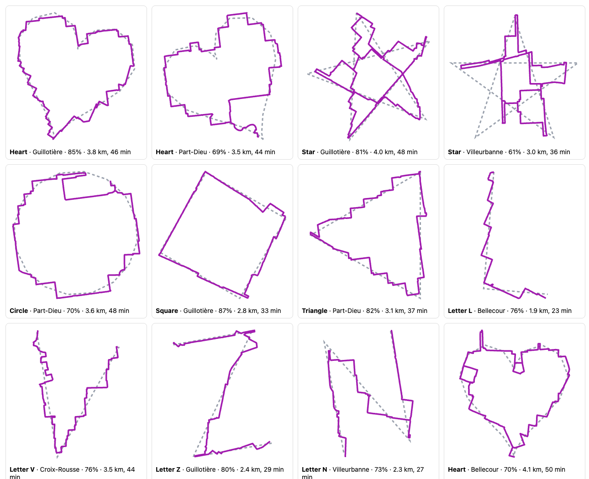

# GPS art: what worked (Phase 6 write-up)

**Goal:** find a walking route whose GPS trace draws a shape or a short word, within the safety rules and a sane length.

**Status:** it works for shapes and one-stroke letters, and it's in the app as an experimental panel. The time spent was limited (Phase 6 was a stretch goal).

## How it works (`app/src/art/`)

1. **Templates** (`shapes.ts`): heart, star, circle, square and triangle, plus letters you can draw without lifting the pen (L, M, N, U, V, W, Z). Each is a polyline in a unit box.
2. **Sizing by time, not metres.** You choose a walk of about 25, 40 or 55 minutes. The shape is scaled so its outline, times a typical street-detour factor (1.25), takes that long at 1.3 m/s.
3. **Placement search.** The shape's first point is anchored at your start, so you begin where you are. The search then tries:
   - 5 rotations (±30° for shapes, ±10° for letters)
   - 3 sizes (80–100% of the target)
   - 5 small offsets (100 m)
   That's 75 placements. Each is scored by the mean distance from points along the outline to a precomputed cloud of points every 20 m along every walkable edge.
4. **Tracing.** For the 4 best placements:
   - It routes corner to corner with a *corridor* cost: walking time × (1 + (distance from the ideal line / 30 m)²), capped at ×60.
   - It trims walk-in-walk-out spurs.
   - It keeps the best-scoring trace under 60 minutes.
5. **Score.** A symmetric mean distance ("chamfer") between the walked trace and the shape, both sampled every 20 m, relative to the shape's width: `likeness = 1 − mean / (8% of width)`. By eye, 80% or more reads clearly, around 70% is recognisable but rough, and under 60% is a stretch.
6. **Safety.** Every leg is an ordinary router search, so excluded ways never appear. Each drawing passes `assertRouteSafe` with a 60-minute limit, the same as the detour cap's absolute maximum. The safety property test draws random shapes from random start points and checks every result with its independent oracle.

## Results on Lyon

Nine shapes × five neighbourhoods (Presqu'île, Part-Dieu, Croix-Rousse, Guillotière, Villeurbanne) × three lengths: 135 attempts, **130 drawn**.

| Shape | Drawn | Median likeness | Best |
|---|---:|---:|---:|
| Letter L | 15/15 | 85% | 91% |
| Letter V | 15/15 | 80% | 88% |
| Square | 14/15 | 78% | 87% |
| Triangle | 15/15 | 78% | 85% |
| Letter Z | 15/15 | 75% | 85% |
| Letter N | 15/15 | 73% | 86% |
| Heart | 13/15 | 70% | 85% |
| Circle | 14/15 | 70% | 83% |
| Star | 14/15 | 64% | 81% |

Planning takes median 115 ms, max 267 ms on a laptop, in the Web Worker. Reproduce with `npx vitest run --config vitest.bench.config.ts app/bench/art.bench.ts`.

## What worked

- **Corridor costs** turn "draw a line" into ordinary shortest-path search, keeping every safety guarantee for free.
- **Sizing by walk time** was the single biggest improvement. Sizing in metres failed 60% of attempts because shapes blew the one-hour limit. By time, 130 of 135 succeed.
- **Cheap placement search** over a point cloud of the network picks good fits before any routing happens.
- **Spur trimming** removes the dead-end stubs that snapping corners to junctions creates.
- **Straight-edged shapes and letters** suit a city of streets. Guillotière's regular grid is the best canvas in Lyon.

## What didn't, or isn't done

- **Stars** are the weakest: sharp points and self-crossing lines fight the grid.
- **Curves in irregular districts:** circles and hearts pick up notches where a block forces a detour.
- **Rivers:** shapes overlapping the Rhône or Saône fail or distort. The placement search only nudges by 100 m.
- **Words:** most letters need the pen lifted, which a walk can't do. Joining letters with connecting strokes is possible but reads poorly, so it's left for later.
- **Likeness is geometric only.** It doesn't know that a heart's cusp matters more than a wobble on its side.

## Ideas for later

- Search placement more widely (larger offsets, finer rotations) when the first fits are poor, and explain the best alternative ("a heart fits better 400 m east").
- Weight the score by key points such as corners, tips and the heart's cusp.
- Joined-letter words for short, friendly ones (e.g. "LOVE" with visible joins), presented honestly as a sketch.
- Let people draw their own shape on the map, drawn and stored on the device.
